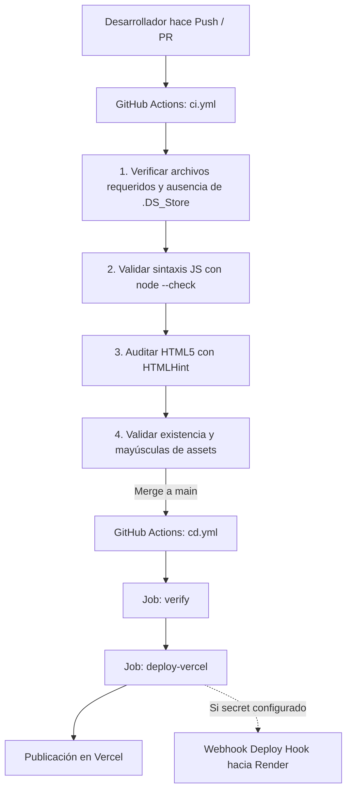

# Moda y Estilo Única 👗
> Plataforma de comercio electrónico para venta de moda femenina. Proyecto desarrollado para el curso **Herramientas de Desarrollo** — **Avance de Proyecto Final 3 (APF3)**.

[](https://github.com/JoseCaja/proyecto_hd_ap1/actions/workflows/ci.yml)
[](https://github.com/JoseCaja/proyecto_hd_ap1)
[](https://vercel.com)

---

## 📌 Descripción del Proyecto

**Moda y Estilo Única** es una plataforma web orientada al comercio electrónico de prendas de vestir y calzado femenino. En esta etapa del ciclo de vida del software (**APF3 - Versión Candidata v0.9.0-rc.1**), el repositorio ha sido optimizado y dotado de prácticas modernas de ingeniería de software:
- Higiene rigurosa y portabilidad del código fuente.
- Normalización y optimización de recursos multimedia (formatos ligeros WebP y nomenclatura `kebab-case`).
- Control de calidad mediante análisis estático de código HTML5 y verificación de sintaxis JavaScript.
- Automatización integral mediante flujos de **Integración Continua (CI)** y **Entrega Continua (CD)** con GitHub Actions hacia la nube en **Vercel**, con soporte desacoplado para servicios backend en **Render**.

---

## 🌐 Despliegue en la Nube

El frontend estático se encuentra configurado para su despliegue continuo en producción:

- **Enlace de Producción (Vercel):** `[URL de producción en Vercel]`
- **Plataforma:** Vercel (Edge Network con compresión y cabeceras de caché inmutable para recursos estáticos).
- **Backend (Preparado):** Render (mediante Webhook / Deploy Hook automatizado).

---

## 🎯 Objetivos de la Entrega (APF3)

1. **Higiene y Estandarización:** Exclusión estricta de archivos locales del sistema operativo (`.DS_Store`) y configuraciones de editor (`.vscode`), estandarizando nombres de recursos multimedia para evitar errores 404 en servidores Linux.
2. **Optimización de Rendimiento:** Reducción drástica del peso del catálogo gráfico convirtiendo imágenes PNG pesadas a formato `.webp` de alta fidelidad (< 300 KB).
3. **Control de Calidad Automático (CI):** Ejecución desatendida de validación de sintaxis ECMAScript, auditoría HTML5 (`.htmlhintrc`) e integridad de rutas internas.
4. **Despliegue Automatizado (CD):** Publicación automática en Vercel tras la integración exitosa de cambios validados en la rama `main`.

---

## 🧱 Estructura del Repositorio

```text
proyecto_hd_ap1/
├── .github/
│   └── workflows/
│       ├── ci.yml                 # Pipeline de Integración Continua (CI)
│       └── cd.yml                 # Pipeline de Entrega Continua (CD) hacia Vercel y Render
├── .gitignore                     # Exclusiones de Git (SO, IDEs, dependencias, Vercel)
├── .htmlhintrc                    # Reglas estándar de análisis estático HTML5
├── assets/                        # Recursos gráficos optimizados (WebP / JPG en kebab-case)
│   ├── acerca.jpg
│   ├── baggy-jeans.jpg
│   ├── banner-login.jpg
│   ├── banner.jpg
│   ├── blusa.jpg
│   ├── botines-negros.webp
│   ├── calzado-damas.jpg
│   ├── chaqueta.jpg
│   ├── contacto.jpg
│   ├── jeans-clasico.jpg
│   ├── jeans-rectos.webp
│   ├── jeans-skinny.webp
│   ├── jeans-wide-leg.webp
│   ├── polo.jpg
│   ├── sandalias-beige.webp
│   ├── sueter.jpg
│   ├── top.jpg
│   ├── vestido.jpg
│   └── zapatillas-blancas.webp
├── acercade.html                  # Historia, horario e iframe responsivo de Google Maps
├── carrito.html                   # Carrito interactivo con desglose de subtotal, IGV y promociones
├── contacto.html                  # Formulario y canales de atención al cliente
├── index.html                     # Portada principal con carrusel/banner y productos destacados
├── login.html                     # Registro y visualización de usuarias con validación regex
├── producto-blusa.html            # Ficha detallada de producto individual
├── script.js                      # Lógica de negocio (carrito, stock dinámico, validaciones)
├── styles.css                     # Sistema de diseño, layout responsivo y botón flotante
├── tienda.html                    # Catálogo categorizado de prendas, calzado y jeans
├── vercel.json                    # Configuración de despliegue y caché estática en Vercel
└── README.md                      # Documentación técnica integral
```

---

## 💻 Instrucciones de Ejecución Local

Dado que el frontend es completamente estático, no requiere instalación de dependencias pesadas. Puedes utilizar cualquiera de los siguientes métodos:

### Opción 1: Con Live Server (Recomendada en IDEs)
1. Instala la extensión **Live Server** en tu editor (VS Code / Antigravity IDE).
2. Haz clic derecho sobre `index.html` y selecciona **"Open with Live Server"**.
3. El sitio se abrirá automáticamente en `http://127.0.0.1:5501`.

### Opción 2: Con Node.js (`serve`)
```bash
# Servir en el puerto por defecto (3000 o siguiente disponible)
npx serve .
```

### Opción 3: Con Python 3
```bash
# Iniciar servidor HTTP en el puerto 5501
python3 -m http.server 5501
```
Abre tu navegador en `http://localhost:5501`.

---

## 🔄 Flujo de Trabajo Git y Gestión Colaborativa

El equipo utiliza una metodología ágil y colaborativa inspirada en **Git Flow**:

1. **Ramas Protegidas:**
   - `main`: Contiene código estable, validado por CI y desplegable en producción.
   - `feature/<funcionalidad>`: Ramas de trabajo para nuevas características.
   - `fix/<correccion>`: Ramas para resolución de incidencias.

2. **Estándar de Commits (Conventional Commits):**
   Todos los mensajes siguen la convención estándar en español con título y descripción:
   - `chore(git):` Mantenimiento de configuración, exclusiones o tareas administrativas.
   - `fix(assets):` / `fix(frontend):` Corrección de errores en recursos o vistas.
   - `perf(assets):` Mejoras de rendimiento y compresión de archivos.
   - `ci(actions):` Cambios en los flujos de Integración Continua.
   - `cd(vercel):` Configuración y pipelines de Entrega Continua.
   - `docs(readme):` Actualizaciones en la documentación técnica.

3. **Ciclo de Integración:**
   - Se crea un **GitHub Issue** detallando el requerimiento o bug.
   - Se abre una rama específica vinculada al Issue.
   - Se implementan los commits atómicos correspondientes.
   - Se abre un **Pull Request (PR)** hacia `main`, el cual dispara automáticamente el flujo de CI.
   - Tras la aprobación y merge del PR, el pipeline de CD publica los cambios en Vercel y cierra los Issues asociados (`Closes #ID`).

---

## ⚙️ Arquitectura de Pipelines CI/CD

El repositorio implementa dos flujos de trabajo desacoplados en `.github/workflows/`:



### 1. Integración Continua (`.github/workflows/ci.yml`)
- **Disparadores:** `push` y `pull_request` sobre la rama `main`, y `workflow_dispatch`.
- **Validaciones automatizadas:**
  1. Integridad de archivos obligatorios y ausencia de artefactos no deseados (`.DS_Store`).
  2. Análisis de sintaxis JavaScript en `script.js` con el motor oficial de Node.js (`node --check`).
  3. Linter HTML5 con `htmlhint` bajo las reglas de `.htmlhintrc`.
  4. Auditoría de rutas locales: comprueba que cada imagen referenciada en el HTML exista físicamente y coincida exactamente en mayúsculas/minúsculas.

### 2. Entrega Continua (`.github/workflows/cd.yml`)
- **Disparadores:** `push` sobre `main` y ejecución manual (`workflow_dispatch`).
- **Etapas:**
  1. `verify`: Revalida la integridad del código fuente antes de iniciar cualquier despliegue.
  2. `deploy-vercel`: Compila y publica los artefactos optimizados en **Vercel** usando `vercel pull`, `vercel build --prod` y `vercel deploy --prebuilt --prod`.
  3. `render-hook` (opcional / desacoplado): Envía una petición `POST` al Webhook de **Render** (`RENDER_DEPLOY_HOOK_URL`) cuando se habilita una API o backend complementario, sin interrumpir el despliegue del frontend si el secret no está configurado.

#### Secrets Requeridos en GitHub para Producción:
- `VERCEL_TOKEN`: Token de autenticación de la cuenta de Vercel.
- `VERCEL_ORG_ID`: Identificador de la organización / equipo en Vercel.
- `VERCEL_PROJECT_ID`: Identificador del proyecto en Vercel.
- `RENDER_DEPLOY_HOOK_URL` *(opcional)*: URL del Deploy Hook proporcionado por Render para el backend.

---

## 👥 Equipo de Desarrollo y Roles

| Integrante | Rol Principal | Responsabilidades |
| :--- | :--- | :--- |
| **Edwin Siguas** | *DevOps & Frontend Engineer* | Arquitectura CI/CD (GitHub Actions), despliegue en Vercel/Render, higiene del repositorio y footer global. |
| **Jose Caja** | *Frontend Lead & UI Designer* | Diseño responsive de banners, maquetación general con Bootstrap 5 y coordinación del proyecto. |
| **César Carhuacusma** | *Frontend Developer* | Módulo de ubicación (Google Maps), horarios y vista informativa "Acerca de". |
| **Kelly Idrogo** | *Frontend Developer* | Expansión del catálogo de calzado y jeans, y gestión de contenido multimedia. |
| **Bryam Saldaña** | *Frontend Developer* | Integración de botón flotante de WhatsApp, vistas de contacto y flujo de carrito. |

---

## 📜 Historial de Cambios y Versiones

- **v0.9.0-rc.1 (APF3):**
  - Implementación de pipelines de CI (`ci.yml`) y CD (`cd.yml`).
  - Configuración de `vercel.json` con cabeceras de caché inmutable.
  - Conversión de recursos multimedia pesados a formato WebP optimizado (< 300 KB).
  - Reglas de calidad con `.htmlhintrc` y corrección de stock dinámico para todo el catálogo.
  - Limpieza profunda de Git (`.gitignore` ampliado, retiro de `.DS_Store` y `.vscode`).
- **v0.2.0 (AP2):**
  - Incorporación de botón flotante de WhatsApp y mejoras en el responsive del carrito.
  - Ampliación de catálogo con calzado femenino y pantalones jeans.
  - Integración de Google Maps en vista Acerca de.
- **v0.1.0 (AP1):**
  - Estructura base HTML5/CSS3/JavaScript con flujo de trabajo colaborativo en Git/GitHub.